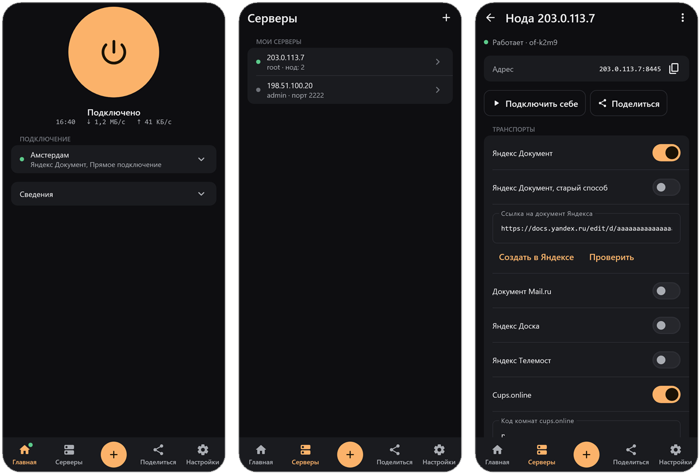

<p align="center">
  
</p>

<h1 align="center">OpenFlux</h1>

<p align="center">
  A tunnel that rides on ordinary web services, with pluggable transports and two exit-node backends.
</p>

<p align="center">
  <a href="../../releases/latest"></a>
  <a href="LICENSE"></a>
  
</p>

<p align="center">
  <b>English</b> · <a href="README.ru.md">Русский</a>
</p>

<p align="center">
  <a href="https://github.com/p1neappleXpress/OpenFlux">Core</a> · <a href="https://github.com/p1neappleXpress/OpenFluxDesktop">Desktop</a> · <a href="https://github.com/p1neappleXpress/OpenFluxAndroid">Android</a> · <a href="https://testflight.apple.com/join/BwnAcdus">iOS (TestFlight; the App Store release is coming)</a>
</p>

<p align="center">
  
</p>

Network stack research tool. IPv4 TCP/UDP tunnel with pluggable transports
(including a signed JS scripting engine for writing new ones), a batched +
zstd codec, and two exit-node backends (L3 raw forward / L4 gVisor proxy).

# Disclaimer

The author of OpenFlux **does not encourage** the use of this project to bypass
restrictions or violate the rules of any platform, and **is not responsible**
for the final scenarios of how users apply this tool in real life or on the
Internet. Any specific technical features of the application are nothing more
than an **architectural coincidence**, created **without any intent**.

The project is **entirely non-commercial**, contains **no paid features, hidden
subscriptions, or commercial benefit**.

The author **is not responsible** for forks, modifications, or derivative
versions of OpenFlux created by third parties. Any changes added to a fork are
the responsibility of its author.

The author **is not responsible** for:

- Any use of OpenFlux by third parties
- Consequences caused by the use of forks and modifications
- Damage resulting from derivative versions
- Violations committed using forks

The original code is provided **as is**, **without any warranties**.

## Clients

| Platform | Download | Notes |
|----------|----------|-------|
| **macOS**   | build from source | CLI + utun L3 client (`--inbound=tun`, default on macOS) |
| **Linux**   | build from source | CLI client (SOCKS5) / exit node (L3 or L4) |
| **Windows** | build from source | CLI client (SOCKS5, or `--inbound=tun` via Wintun - needs administrator) / exit node (`l4`, or `l3` via QEMU - see docs) |
| **Desktop** | [OpenFluxDesktop releases](https://github.com/p1neappleXpress/OpenFluxDesktop) | Windows/macOS/Linux: full tunnel or SOCKS5/HTTP proxy, multi-transport sessions, encryption, an in-app node-deployment wizard over SSH |
| **Android** | [OpenFluxAndroid releases](https://github.com/p1neappleXpress/OpenFluxAndroid) | System-wide VPN or local SOCKS5, multi-transport sessions with failover, encryption, captcha handling in a built-in browser |
| **iOS**     | [TestFlight beta](https://testflight.apple.com/join/BwnAcdus) | System-wide VPN via Network Extension |

> **iOS app** built by [@saharev1](https://github.com/saharev1) - full iOS client,
> TestFlight pipeline, system VPN support, DNS-over-TLS, and many stability fixes.
> HUGE thanks!
>
> **OpenFluxAndroid and OpenFluxDesktop** run a Compose Multiplatform app and a
> shared module (multi-transport sessions, encryption, the built-in browser for
> captcha, the SSH node-deployment wizard) originally written by
> [@meepo161](https://github.com/meepo161) in
> [OpenFluxClient](https://github.com/meepo161/OpenFluxClient) and moved into
> these repositories with his agreement. HUGE thanks!
>
> **Android app** - [p1neappleXpress/OpenFluxAndroid](https://github.com/p1neappleXpress/OpenFluxAndroid),
> **desktop app** - [p1neappleXpress/OpenFluxDesktop](https://github.com/p1neappleXpress/OpenFluxDesktop),
> the module they share - [p1neappleXpress/OpenFluxClientShared](https://github.com/p1neappleXpress/OpenFluxClientShared).

<p align="center">
  
</p>

## How it works

```
Client (any):  macOS (utun) / Linux / Windows / iOS (packet tunnel) / Android
                    |
                    v
               Transport (Yandex.Docs / Volga / Board / MAX / Cups / Mail.ru / Direct / script)
                    |
                    v
               Exit node  -->  Internet
                 --mode l3   (raw SNAT/DNAT, Linux + root)
                 --mode l4   (gVisor proxy, any platform)
```

Any client works with either exit backend; `--mode` is chosen on the exit
node, not the client. `l3` forwards raw TCP/UDP with SNAT/DNAT and stays
end-to-end (Linux + root only); `l4` terminates TCP/UDP in a userspace
gVisor stack and re-dials the real server (any OS, no root). A
multi-transport session can run several transports at once and fail over
between them. Full depth: [docs/architecture.md](docs/architecture.md).

## Quickstart

```bash
go mod tidy
go build -o openflux .

# Exit node, L4 backend (any OS, no root)
./openflux --role=exit --mode=l4 --transport=yandex --url="YOUR_YANDEX_DOC_URL"

# Client, SOCKS5 (point a browser at 127.0.0.1:1080)
./openflux --role=client --inbound=socks5 --transport=yandex --url="YOUR_YANDEX_DOC_URL"
```

See [docs/architecture.md](docs/architecture.md) for the `l3` (root,
Linux-only, faster) backend and the macOS/Windows full-tunnel clients, and
[docs/cli-reference.md](docs/cli-reference.md) for every flag.

## Highlights

- **Pluggable native transports** - Yandex.Docs, Yandex Volga, Yandex Board,
  MAX/OneMe, Cups.online, Mail.ru Docs, Direct.
- **Scripted transports** - a signed JS engine (`transport/script`, goja)
  for writing new transports without touching Go or rebuilding the core.
  See [docs/scripted-transports.md](docs/scripted-transports.md).
- **Multi-transport sessions** with authenticated negotiation, encryption
  and failover. See [docs/sessions.md](docs/sessions.md).
- **Two exit backends** - `l3` (raw SNAT/DNAT) and `l4` (gVisor proxy).
  See [docs/architecture.md](docs/architecture.md).
- **Mode without a server** - the exit can be a small PHP program on any
  web hosting instead of a VDS. See [docs/phpbox.md](docs/phpbox.md).
- **Node provisioning wizard** - `--node-wizard` installs an exit on a VDS
  over SSH, non-interactively, from a desktop app.
  See [docs/node-provisioning.md](docs/node-provisioning.md).
- **Shareable links and QR codes** - an `openflux://` link carries a full
  client configuration. See [docs/links.md](docs/links.md).
- **Captcha handling**, **batched + zstd codec** (with a legacy per-packet
  fallback), **optional AES-256-GCM encryption**, and **benchmark modes**
  for raw goodput. See [docs/transports.md](docs/transports.md) and
  [docs/architecture.md](docs/architecture.md).

## Read next

1. **[docs/architecture.md](docs/architecture.md)** - the client/exit
   diagram, the two exit backends, the repo layout, and current
   limitations.
2. **[docs/transports.md](docs/transports.md)** - the native transport
   list, codec selection, captcha handling, and how to add a native one.
3. **[docs/scripted-transports.md](docs/scripted-transports.md)** - the JS
   transport engine: the host API, signing and trust, the dev tools.
4. **[docs/sessions.md](docs/sessions.md)** - multi-transport sessions,
   `.conf` files, authenticated negotiation and encryption.
5. **[docs/links.md](docs/links.md)** - the `openflux://` link/QR format.
6. **[docs/node-provisioning.md](docs/node-provisioning.md)** - the SSH
   node wizard.
7. **[docs/phpbox.md](docs/phpbox.md)** - the no-VPS PHP-hosting exit.
8. **[docs/logging.md](docs/logging.md)** - `-d`/`-dd`/`-ddd` and
   `--sensitive`.
9. **[docs/cli-reference.md](docs/cli-reference.md)** - every flag, flat.
10. **[docs/building-and-releases.md](docs/building-and-releases.md)** -
    CI, tagged releases, exit-node releases, and the nightly channel.

Wire-level protocol framing lives at
[PROTOCOL_NEGOTIATION.md](PROTOCOL_NEGOTIATION.md) (linked from the docs
above where it's relevant, not duplicated here).

## What's in this repo

- `docs/` - the guides above.
- `transport/` - every transport (native and scripted) and the session
  manager.
- `tunnel/` - the client-side virtual NIC and both exit backends.
- `provision/` - the SSH node-provisioning backend and the no-VPS PHP
  deployer.
- `deploy/` - the VDS installer script and the PHP exit's own sources.
- `share/` - the `openflux://` link format.
- `socks5/`, `netbind/`, `utils/` - the SOCKS5 server, Windows interface
  binding, and logging.
- `mobile/`, `ios-app/` - the Android/iOS bridges and the SwiftUI iOS app.
- `.github/workflows/` - CI and the three release channels (tagged,
  exit-node, nightly).

## Requirements

1. **Go** - see `go.mod` for the exact version.
2. **Android NDK r27+** / **Xcode 26.6+** - only for the mobile client binaries.
3. **A Linux VPS / VDS** for a VPS-hosted exit node (not needed for the
   no-VPS PHP exit - [docs/phpbox.md](docs/phpbox.md)). `l3` needs root;
   `l4` doesn't.

## Status

The core tunnel path (native transports, the `l3`/`l4` exit backends,
multi-transport sessions, encryption/negotiation) is CI-tested on every
push and has shipped across several tagged releases - see
`CHANGELOG.md`. The scripted-transport engine and the no-VPS PHP exit are
newer and still gaining real-world coverage; a Windows/macOS native `l3`
exit backend is not implemented yet (the working fallback is `l4` on both).
The nightly prerelease channel (`.github/workflows/nightly.yml`) tracks
the `nightly` branch for anyone who wants a current build ahead of the
next tagged release.

## License

GNU General Public License v3.0 or later. See LICENSE for the full text.

Third-party licenses are listed in [NOTICE](NOTICE).
